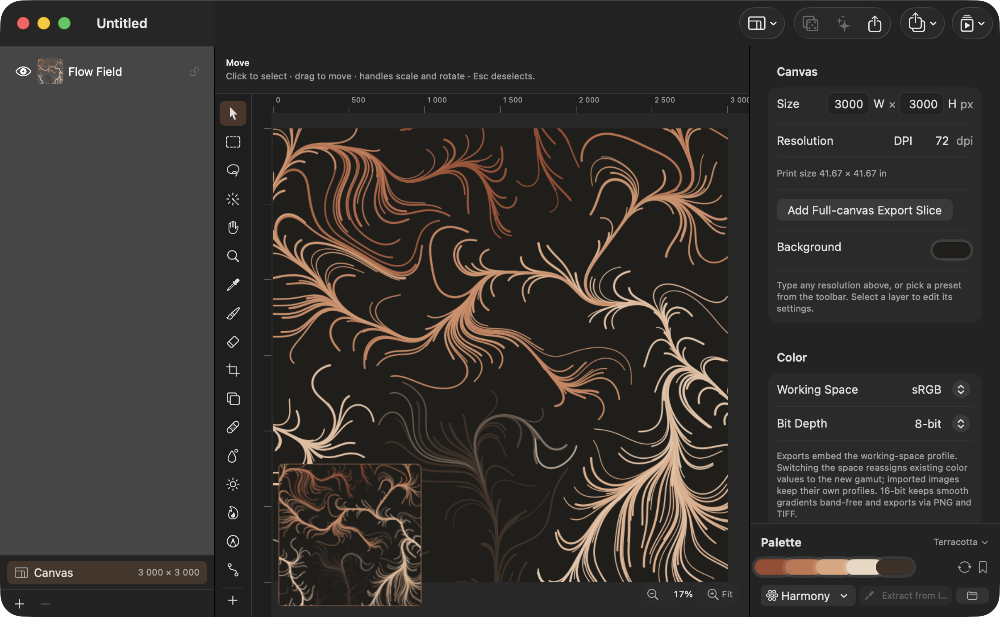

# PixelFailure

**A native macOS image editor where generative art, pixel editing, vector tools, and professional compositing meet.**

PixelFailure is a SwiftUI document-based editor for creating deterministic generative artwork and refining it with a full layer workflow. Combine seeded patterns with photographs, editable vectors, typography, masks, adjustments, retouching, and animation—then export the result for the web, print, or further production work.



## Highlights

- **Deterministic generators** — Build repeatable artwork with flow fields, waves, rings, phyllotaxis, Truchet patterns, grids, and image-sampled mosaics.
- **Layer-based editing** — Organize images, patterns, shapes, text, fills, paint, paths, adjustments, and groups with masks, opacity, blend modes, and clipping.
- **Professional color pipeline** — Work in sRGB or Display P3, preserve embedded profiles, choose 8- or 16-bit document depth, and export profile-aware raster files.
- **Non-destructive workflow** — Transform layers, build effect stacks, retain original raster sources, and move through named history states and snapshots.
- **Selection and retouching tools** — Use geometric and freeform selections, magic wand and subject selection, feathering, content-aware fill, patch healing, and painting tools.
- **Vector and type tools** — Create editable shapes and paths, style text ranges, flow text through areas or along paths, and preserve vectors in SVG output.
- **Animation** — Keyframe layer properties on a timeline and export animated work.
- **Studio-friendly interoperability** — Import and export layered PSD files, create export slices, print with DPI-aware sizing, and preview project thumbnails with Quick Look.
- **Automation** — Run batch operations, record and replay actions, use keyboard shortcuts, or integrate with AppleScript.

## Export formats

PixelFailure can export PNG, JPEG, TIFF, HEIC, WebP, PDF, SVG, and layered PSD files. Raster exports support embedded color profiles, while SVG keeps supported patterns, shapes, and outlined text as true vectors.

Projects are saved as self-contained `.pixelfailure` document packages.

## Requirements

- macOS 15.0 or later
- Xcode 16 or later with the macOS SDK
- [XcodeGen](https://github.com/yonaskolb/XcodeGen) when regenerating the Xcode project

## Build and run

1. Clone the repository:

    ```bash
    git clone <repository-url>
    cd PixelFailure-image-tool
    ```

2. Generate the Xcode project:

    ```bash
    xcodegen generate
    ```

3. Open `PixelFailure.xcodeproj` in Xcode, select the **PixelFailure** scheme, and run the app.

You can also build from the command line:

```bash
xcodebuild \
  -project PixelFailure.xcodeproj \
  -scheme PixelFailure \
  -configuration Debug \
  build
```

## Tests

Run the test suite from Xcode with **Product → Test**, or from the command line:

```bash
xcodebuild \
  -project PixelFailure.xcodeproj \
  -scheme PixelFailure \
  -destination 'platform=macOS' \
  test
```

## Project structure

```text
PixelFailure/
├── App/          Application entry point and automation
├── Core/         Color, parameters, primitives, noise, and seeded RNG
├── Document/     Project files, import/export, and workflow operations
├── Effects/      Core Image effect pipeline
├── Generators/   Deterministic pattern generators
├── Model/        Layers, transforms, effects, palettes, and project state
├── Painting/     Brush and paint-session implementation
├── Rendering/    Canvas, raster, vector, and animation rendering
├── Selection/    Selection tools, rasterization, and smart imaging
└── Views/        SwiftUI editor interface and inspectors
```

The Quick Look extension lives in `QuickLookExtension/`, and the Xcode project is generated from `project.yml`.

## Development status

PixelFailure is still early in the development and worked on as a sideproject.
